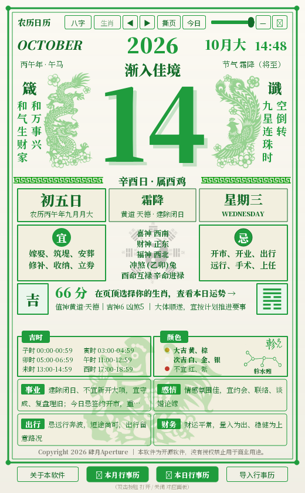
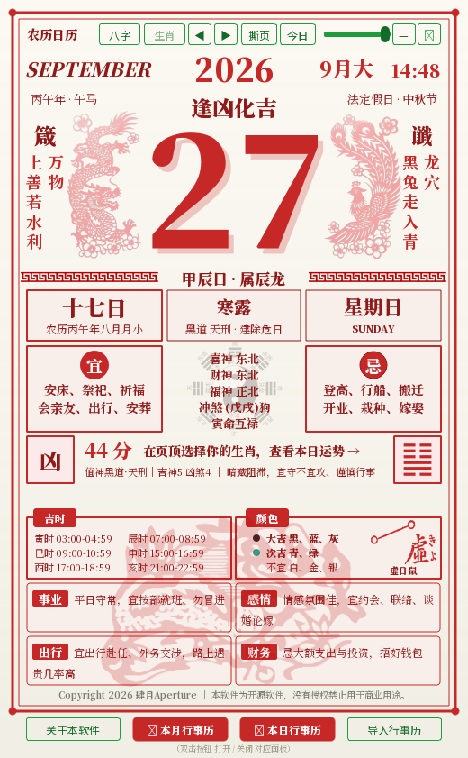
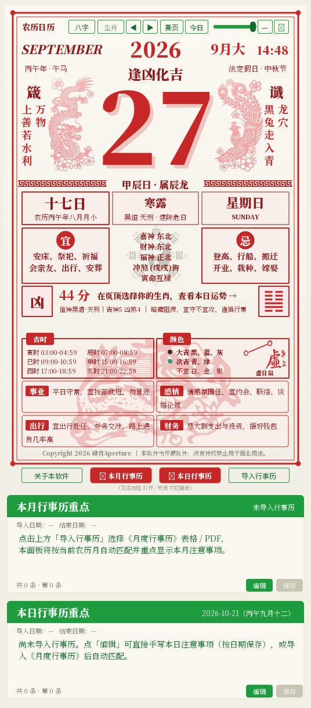
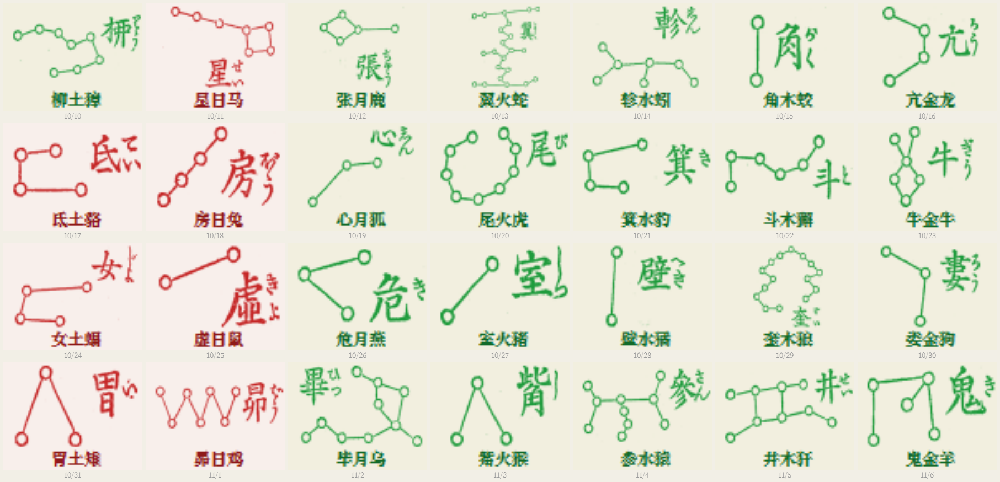

<div align="center">


# 🗓️ 农历日历 · SiYue Calendar

**桌面无边框 · 纸质撕页风格 · 两广港澳通书口径的老黄历**

-c0392b?style=flat-square)


-41cd52?style=flat-square\&logo=qt)


*全部界面用 `QPainter` 手绘，PyInstaller 打成单个 exe，双击即用。*

[功能特性](#-功能特性) · [界面预览](#-界面预览) · [快速开始](#-快速开始) · [使用教程](#-使用教程) · [目录结构](#-目录结构) · [更新日志](#-版本迭代记录)

</div>

---

> 一个**完全离线**的 Windows 桌面单机软件：把两广·港澳传统撕页老黄历搬到桌面上 —— 纸色底、单色印、竖排箴言谶言、巨大日期数字、左龙右凤剪纸水印、每日 0:00 自动撕页。
>
> 不是网页套壳，不是 Electron：全部界面用 `QPainter` 手绘，PyInstaller 打成**单个 exe**，双击即用。
>
> - **大版本号**：`v1.9.27`
> - **内部版本号规则**：`YYMMDD` + 4 位当日迭代序号（例如 `2610210028` 表示 2026-10-21 第 28 次构建）
> - **版权**：Copyright 2026 肆月Aperture。本软件为开源软件，未经授权禁止用于任何商业用途。

---

## ✨ 功能特性

| # | 功能               | 说明                                                                                                                                                                                                     |
| - | ---------------- | ------------------------------------------------------------------------------------------------------------------------------------------------------------------------------------------------------ |
| 1 | **撕页日历主页**       | 桌面无边框、无外框工具条，全部功能按钮内嵌于日历纸面；老黄历单色印制版式：公历 / 农历 / 干支 / 建除十二神 / 黄黑道值神 / 节气；**每日 0:00 自动撕页**到新的一天                                                                       |
| 2 | **宜 · 忌**         | 两广·港澳通书**宽松口径**（宋韶光 / 永经堂 / 广经堂体例），逐日推算合成而非抄固定表                                                                                                                                 |
| 3 | **今日整体运势**       | 建除 + 值神 + 吉神凶煞加权合成 0–100 分，分 上吉 / 吉 / 平 / 凶 / 大凶 五档，并在年份下方显示对应成语                                                                                                       |
| 4 | **箴言 / 谶言**      | 大日期两侧竖排当日箴言（修身格言）与谶言（当日征兆），按日期种子逐日轮换                                                                                                                                                   |
| 5 | **今日卦象**         | 六十四卦「年月日」**梅花易数**起卦（与吉/平/凶框左右对称），悬停出卦名 / 上下卦 / 简释 / 起卦依据                                                                                                                   |
| 6 | **二十八宿星图**       | 当日值日星宿（宿名 / 七曜 / 宿禽 / 吉凶 / 四象 / 方位）+ **古刻本星图**，画在「颜色」卡右侧；v1.9.22 起新增，v1.9.23 去框，v1.9.24 改用自带古刻本 PNG 素材并按主题红 / 绿着色                                                                  |
| 7 | **神煞方位 / 吉时**    | 喜神 · 财神 · 福神方位、冲煞、日禄；当日黄道吉神当值的时辰（时辰干支 + 时间段，最多 6 个）                                                                                                                                 |
| 8 | **吉凶颜色 / 分项建议**  | 穿衣五行：大吉（生我者色）/ 次吉（同我者色）/ 不宜（克我者色）附色卡圆点；事业 / 感情 / 出行 / 财务四栏当日建议                                                                                                        |
| 9 | **法定假日红题**       | 命中法定假日当日整页切换红色印制，副行标注假名；**调休上班的周末保持绿色**（不冒充法定假日）                                                                                                                                 |
| 10 | **本日生肖**        | 页顶选择生肖，按「日支 ↔ 生肖支」合冲派（三合 / 六合 / 值日 / 六冲 / 六害 / 相刑 / 自刑）给出当日分值与建议                                                                                                       |
| 11 | **八字推演**        | 顶栏「八字」录入四柱（公历 / 农历 + 年月日时），以「日主 vs 当日干支」做五合 / 相冲 / 五行生克 / 六合 / 六冲 / 六害 / 相刑 / 生肖合冲三合推演；**个人分恒在「本命生肖分 ±10」内**，录入持久化至 `settings.json`                                        |
| 12 | **祭拜三清彩蛋**      | 在巨大日期上连续点击 **10 次**触发：三清圣像 + 香炉整尊绘制，可「敬香」祈福（三炷香缓缓燃短、青烟袅袅），纯民俗体验                                                                                                        |
| 13 | **行事历（月度 · 本日）** | 一键下载 `月度行事历模板.xlsx`（openpyxl 生成）；导入 Excel / CSV / PDF / Word（**内置离线智能解析**，不联网、不用模型）；面板右下角直接编辑并标注「✎ 已手工修改」；按日期区间导出三种格式，跨年条目自动推算                                      |
| 14 | **系统托盘常驻**      | 关闭窗口仅隐藏到托盘；托盘左键 / 双击恢复，右键菜单「显示 / 隐藏 · 初始化位置 · 关于本软件 · 退出」                                                                                                                    |
| 15 | **贴边吸附 / 位置记忆** | 拖动距屏幕边缘 ≤14px 自动贴边（多显示器跟随所在屏幕，**只贴边不隐藏**）；位置随 `settings.json` 持久化，坐标失效时回桌面正中                                                                                         |
| 16 | **透明度 / 页顶时分**  | 顶栏滑块 30%–100% 自动记忆；页头实时显示当前时分（HH:MM，每 15 秒刷新）                                                                                                                                         |
| 17 | **开机自动启动**      | 关于页可开启（写入当前用户注册表 `Run` 键，无需管理员）                                                                                                                                                            |
| 18 | **进程与解包目录自愈**   | 启动时清理残留进程；单文件 exe 的 `%TEMP%\_MEIxxxxxx` 解包目录有自愈回收，不泄漏磁盘                                                                                                                      |
| 19 | **国定假日可导入**     | 「关于本软件 → 国定假日导入」三键：下载 Excel 模板 / 导入 `.xlsx`·`.csv` / 恢复内置；数据落 `holidays.json`，**同一年整体覆盖内置、其余保留**                                                                                     |
| 20 | **等比例缩放**        | 左右下角各有一枚小三角手柄，**鼠标移入才显示**；按住拖动 = 整窗等比缩放（右下锚左上、左下锚右上），`60%–200%`、以屏幕可容纳为上限，比例记忆到 `settings.json`。缩放走场景变换，页面自绘坐标与 QSS 尺寸全部保持原值，**布局与所有点击 / 悬停命中零影响** |

---

## 🖼 界面预览

> 以下截图存于仓库 `docs/screenshots/`，与 README 一起提交发布，随仓库版本管理，不会因更新而失效。
>
> （推送到 GitHub 时请连同 `docs/screenshots/` 目录一起提交）

| 绿日（平日） | 红日（法定假日） |
| :----: | :------: |
|  |  |

| 完整窗口（含叠页纸面与边框） | 数字高光流动的瞬间 |
| :------------: | :-------: |
|  |  |

> 截图由 `tools/dev_checks/verify_ui.py` 离屏渲染真实窗口内容生成，所见即所得。  
> 自 v1.8.0 起软件**内置全部字体**（Noto Serif SC / Noto Sans SC 子集），因此字形在任何 Windows 设备上都完全一致。
---

## 🌌 当日二十八宿星图（v1.9.22 起 · v1.9.24 改用古刻本素材）

「颜色」卡右侧一格显示**当日值日星宿**：宿名 / 七曜 / 宿禽 / 吉凶 / 四象 / 方位
取自 `lunar_python`。星图采用**用户自备的 28 张古刻本 PNG**
（`assets/二十八星宿/`，星点 + 连线 + 图上宿字与日文假名），按当前主题**红 / 绿着色**，
贴图前自动**裁到墨迹包围盒**再等比缩放，故 28 天里星图大小一致、不生参差；
下方**仍保留中文三字宿名**（图上小字只作纹样，中文名才是可读信息）。
v1.9.23 起星图**不再自绘外框**（本就在「颜色」卡片内，框套框冗余）。

| 「颜色」卡右侧的星图 | 2026-10-10 起 28 天逐日星图（一屏看全 28 宿） |
| :----: | :----: |
|  |  |

> 二十八宿 28 日一轮回，故连续 28 天恰好覆盖全部 28 宿（已实测）。
> ⚠ 「壁水**獝**」的 獝 (U+735D) 不在内置字体子集内（宿名用字 62 个里唯一缺口），
> 真机走系统字体回退、**离屏渲染会成豆腐块** —— 故本图由 `tools/dev_checks/shot_xiu.py` 在
> **真实平台**渲染（不要用 offscreen 重出这两张图）。
---

## 🚀 快速开始

### 方式一：使用已打包的 exe（推荐）

1. **获取 exe**：从本仓库 [Releases](../../releases) 页面下载最新版 `农历日历.exe`（约 290 MB，单文件），或向作者索取。
2. **无需安装 Python、无需联网、不依赖浏览器** —— 双击即用。
3. 首次启动约需 10–20 秒（单文件 exe 自解包，之后秒开）。

> 仓库内不包含 exe 二进制（体积大且不适合版本管理），请通过 Releases 页面获取；`history/` 目录仅本地留档，不纳入 git。
>
> ⚠️ 因为是 PyInstaller 单文件 exe，部分杀软会误报。源码完全开放，可自行核对或从源码构建。

### 方式二：从源码运行

```bash
pip install PySide6 lunar-python openpyxl pypdf reportlab fonttools brotli
python main.py
```

### 自己打包 exe

```bash
pip install pyinstaller
python -m PyInstaller --noconfirm 农历日历.spec
```

> 打包参数（名称 `农历日历`、`console=False`、`icon='assets/logo.ico'`、`datas` 素材清单）全部写在 `农历日历.spec` 里，不用命令行长参数。
>
> 完整重建约 3.5–4.5 分钟；最新版 exe 放 `dist/`，历史版本自动归档到 `history/`。
>
> 若需重新生成内置字体（仅在改字符集 / 换字体时需要）：`python tools/build_fonts.py`。

---

## 📖 使用教程

### 1. 拖动与窗口控制

- **拖动**：按住窗口空白处或左上角「农历日历」标题行。
- **顶栏**：八字 / 生肖选择 / ◀ 前一日 / 后一日 ▶ / 撕页 / 今日 / 透明度滑块 / 最小化 / 关闭。
- **贴边**：拖到距屏幕边缘 14px 内自动吸附；多显示器会跟随所在屏幕。
- **等比例缩放**：鼠标移到窗口**左下 / 右下角**，角落会出现一枚小三角；按住它拖动即可整窗等比放大或缩小（右下角拖 = 左上角不动，左下角拖 = 右上角不动），中心内容不会错位。范围 60%–200%，比例自动记忆。
- **关闭窗口 ≠ 退出**：点 ✕ 只隐藏到托盘；真正退出请右键托盘图标选「退出」。

### 2. 撕页与翻日

- 点「**撕页**」撕掉当前页翻到明天（带撕页动效）；**每天 0:00 也会自动撕**（每 30 秒轮询，兼顾休眠唤醒）。
- 「前一日 / 后一日」用于回看与预览；「今日」一键回到当天。

### 3. 生肖与八字

- **生肖**：页顶下拉选择（两字显示，如「子鼠」），即时给出本日生肖分与合冲建议。
- **八字**：点顶栏「八字」录入四柱（支持公历 / 农历 + 年月日时），保存后自动按年支**联动选中生肖**，并把子平法推演叠加到「本日运势」行。
- **评分口径**：个人分 = 本命八字生肖在本日的生肖分 ± 10 以内的修正，不会偏离基准超过 10 分。

### 4. 行事历（本月 / 本日）

- 底部一行四个按钮等宽分布；「**本月 · 本日**」按钮**双击**开关对应面板。
- **导入**：先「下载模板」→ 填好 → 「导入行事历」选 Excel / CSV / PDF / Word，内置离线解析自动定位当前农历月并重点显示本月注意事项。
- **编辑**：面板右下角「编辑」改写 → 「保存」落盘（标注「✎ 本条内容已手工修改」）→ 「取消」回退。
- **导出**：两个日期选择器 + Excel / CSV / 文本三种格式，跨年条目自动推算。

### 5. 国定假日导入（每年维护一次）

- 进入「关于本软件 → 国定假日导入」：**下载模板** → 按模板填报 → **导入**。
- 表头只认短单元格（≤8 字）的「类型 / 开始 / 日期」，长填写说明不会被误判成表头。
- **同一年整体覆盖内置、其余年份保留**；不满意可「恢复内置」。

### 6. 祭拜三清（彩蛋）

- 在巨大日期数字上**连续点击 10 次**，弹出三清圣像与香炉，可「敬香」祈福。纯民俗体验，不影响任何功能。

---

## 🔤 内置字体（v1.8.0 起）

不同 Windows 设备的中文字体差异极大（有的缺华文中宋、有的楷体被替换），会直接导致排版错位。因此 v1.8.0 **把字体也打进 exe**：

| 字体            | 字重                     | 用途                 |
| ------------- | ---------------------- | ------------------ |
| Noto Serif SC | Regular / Bold / Black | 正文、标题、巨大日期数字（宋体观感） |
| Noto Sans SC  | Regular / Bold         | 控件、按钮、对话框（黑体观感）    |

- 由 `tools/build_fonts.py` 从 OFL 可变字体**实例化出静态字重**再按 **GB2312 + ASCII + 全角符号**子集化裁剪，5 份共 **12.96 MB / 每份 7554 字形**。
- 运行时 `QFontDatabase.addApplicationFont` 注册，并把族名插到字体回退链最前；**注册失败或系统没有 Qt 实例时自动回退到系统字体**，不影响启动。
- 许可：SIL Open Font License 1.1，见 `fonts/OFL-*.txt`。

---

## 📜 宜忌数据口径与更新周期

> 这是本项目**唯一需要人工定期维护**的数据，单独说明。

### 口径来源

本软件的宜忌**不是**从某本纸质通书里抄的固定表，而是**逐日推算**合成的：

```
lunar_python 天文历算（农历 / 干支 / 二十四节气 / 建除十二神 / 黄黑道值神）
        ↓
  规则表合成：ZHIXING_YIJI（建除十二神宜忌） + TIANSHEN_YIJI（值神宜忌）
        ↓
  两广·港澳通书「宽松口径」合并去重 → 当日宜 / 忌
```

口径体例参考三家**两广·港澳通书**：**宋韶光**、**永经堂**（《永經堂包羅萬有通勝》）、**广经堂**（《廣經堂通勝》）。

### 支持到什么时候

| 数据层                                     | 有效期                                                                                           | 说明                                      |
| --------------------------------------- | --------------------------------------------------------------------------------------------- | --------------------------------------- |
| 农历 / 干支 / 节气 / 建除 / 值神                  | **1900 – 3000**（已实测 1900 / 1920 / 1950 / 2026 / 2033 / 2060 / 2100 / 2200 / 2500 / 3000 全部正常） | `lunar_python` 天文算法，**不存在「用完」的问题**，无需更新 |
| 宜忌规则表（`ZHIXING_YIJI` / `TIANSHEN_YIJI`） | 长期有效                                                                                          | 传统通书体例，属常量规则，不随年份变化                     |
| **法定假日红题表 `STATUTORY_RANGES`**          | **仅内置 2026 / 2027** ⚠️                                                                        | **唯一会过期的数据**，见下                         |

### 什么时候需要更新

**每年一次，且只更新一处**——`calendar_app/engine.py` 里的 `STATUTORY_RANGES`。

| 时间                              | 动作                                                              |
| ------------------------------- | --------------------------------------------------------------- |
| 每年 **10–11 月**（国务院办公厅发布次年放假安排后） | 往 `STATUTORY_RANGES` 加一年的假日区间（元旦 / 春节 / 清明 / 劳动 / 端午 / 中秋 / 国庆） |
| 建议 **每年 12 月** 发一个维护版本          | 顺手 bump 版本号，打包发布                                                |

**过期后的降级行为是安全的，不会报错**：表内查不到时自动走**节日当日兜底识别**（`元旦 / 春节 / 清明 / 劳动 / 端午 / 中秋 / 国庆` 当日仍会红题，只是「调休相连的放假区间」不再整段标红）。也就是说表过期 = 少标红几天，不会崩溃、不会算错宜忌。

> 纸质通书（宋韶光 / 永经堂 / 广经堂）本身也是**每年出一本**（如《廣經堂通勝 2026》《永經堂包羅萬有通勝 2026 丙午年》），本软件用算法替代了这一层，因此**不需要每年抄书**，只需维护法定假日表。

---

## 🗂 目录结构

```
农历日历/
├── main.py                    # 入口：清理残留进程 → 注册内置字体 → 启动 UI
├── ui_main.py                 # MainWindow + 兼容再导出（历史入口，保持可 import）
├── ui/                        # 界面层（v1.8.0 从 ui_main.py 拆分）
│   ├── theme.py               #   素材路径、调色板 palette_for、图片缓存、字体回退链
│   ├── page.py                #   CalendarPage：撕页日历自绘主体
│   ├── agenda.py              #   AgendaPanel / AgendaImportDialog / AgendaExportDialog
│   ├── dialogs.py             #   SanqingDialog（祭拜三清）/ BaziDialog（八字）
│   └── zoom.py                #   ZoomView（场景缩放宿主）+ ScaleGrip（角落三角手柄，v1.9.27）
├── calendar_app/              # 业务层
│   ├── engine.py              #   农历 / 宜忌 / 运势 / 生肖 / 法定假日
│   ├── gua.py                 #   今日卦象：六十四卦 / 梅花易数「年月日」起卦 / 悬停文案
│   ├── xiu28.py               #   二十八宿：宿名表 / 展示口径（矢量线稿已退役为回退备份）
│   ├── holidays.py            #   法定假日与调休上班日（内置表 + 用户导入 holidays.json）
│   ├── agenda_pdf.py          #   行事历：导入解析、模板生成、区间导出、手写覆写
│   ├── fonts.py               #   内置字体安装与族名查询
│   ├── process.py             #   进程清理 + 孤儿解包目录自愈清理
│   ├── bridge.py              #   钦天监对接接口（预留）
│   └── version.py             #   版本信息
├── assets/                    # 全部图片素材（v1.9.26 起集中于此，便于上传 GitHub）
│   ├── 二十八星宿/            #   28 张 300×300 古刻本 PNG（星图，按主题红 / 绿着色）
│   ├── 龙凤/                  #   龙 / 凤 / 云纹剪纸（红 / 绿双色）
│   ├── 生肖/                  #   12 生肖剪影（红 / 绿双色）
│   ├── 祖师爷/                #   三清圣像 + 香炉（祭拜彩蛋）
│   ├── 图标/                  #   联系作者图标（GitHub / B站 / 微博）
│   ├── 八卦.png               #   宜 / 忌中缝八卦水印
│   ├── logo.png / logo.ico    #   应用图标（窗口 / 托盘 / exe）
│   └── _backup/               #   旧版素材备份（不入库）
├── fonts/                     # 内置字体（5 份子集 TTF + OFL 许可）
├── docs/
│   ├── screenshots/           # README 用真实截图（随仓库提交）
│   └── figures/               # 历史版本修复对比图
├── tools/
│   ├── build_fonts.py         # 由 OFL 可变字体生成内置子集
│   ├── split_ui.py            # ui 包拆分的机械脚本（含 AST 校验）
│   ├── clean_workspace.py     # 清理 build/ __pycache__ 等过程文件
│   ├── git_preview.py         # 发布前预览 `git add .` 将提交的文件清单
│   ├── clean_orphan_mei.py    # 一次性回收 %TEMP%\_MEIxxxxxx
│   └── dev_checks/            # 可复跑回归脚本（见「开发校验」）
├── 农历日历.spec              # PyInstaller 打包配置
├── CHANGELOG.md               # 完整迭代记录
├── LICENSE.txt
└── dist/  history/            # 打包产物 / 历史版本归档（均不入库）
```

---

## 🗂 数据说明

运行期数据全部位于 **exe 同目录**（该目录只读时自动回退到 `%APPDATA%\农历日历\`），**不在仓库内**（已由 `.gitignore` 排除）：

- `settings.json`：窗口位置（`win_pos`）/ 透明度 / 八字四柱 / 生肖选择 / 面板可见性 / 开机自启标记 / 上次日期
- `agenda_edit.json`：行事历手工修改覆写
- `agenda_cache.json`：行事历导入解析缓存
- `holidays.json`：用户导入的国定假日表（同一年整体覆盖内置，其余年份保留）

---

## 🧪 开发校验

`tools/dev_checks/` 下全部**离屏运行**（`QT_QPA_PLATFORM=offscreen`），不需要真实显示器：

| 脚本                                       | 作用                                                                                                                                      |
| ---------------------------------------- | ----------------------------------------------------------------------------------------------------------------------------------------- |
| `verify_ui.py`                           | UI 综合复核（**250/250**）：红绿换图、龙凤对位、云纹、图标、三级缓存命中、逐帧耗时、高光相位、调色板 / 版本号回归、卦象框与卦画缩放、调休判色、假日导入、单行缩排、悬停提示紧凑度、**二十八宿星图（素材齐备 / 索引一一对应 / 裁到墨迹 / `xiu_pixmap` 贴图 / 28 天不越带 / 图形↔宿名留白 / 红绿主题着色 / 与 `lunar_python` 一致）**、**分数 / 本日运势行下移 5px**、**素材集中于 `assets/` 后 spec datas 与各路径引用**，**并重生成 README 截图** |
| `probe_fit.py`                           | 单行缩排自适应（**14/14**）：366 天值神行全量不溢出、与「穷举最小代价解」逐日比对、缓存与确定性、`_draw_fit_line` 实测墨迹不越界、极端超长文案优雅退化                                                        |
| `probe_gua.py`                           | 今日卦象（**9/9**）：800 天 **64/64** 卦全覆盖、六爻与 `GUA64` 自洽、起卦公式独立复算、八纯卦命名、分布最稀 / 最密                                                              |
| `probe_holidays.py`                      | 国定假日（**17/17**）：内置表逐条核对、调休日不算法定假日、判色、模板往返（14 段 / 6 天）、同年覆盖 / 跨年保留、CSV / 无表头 / 宽松日期 / 倒置纠正 / 坏文件抛错                                      |
| `probe_bazi_prof.py`                     | 八字个人分口径（**17/17**）：恒在「本命生肖分 ±10」内、年均偏离 ≈ 0、低分不泛滥                                                                                     |
| `probe_bazi_scale.py`                    | 八字分项归因 / 偏离分布（诊断工具，打印分档占比表）                                                                                                    |
| `window_mode_probe.py`                   | **任务栏两态实测（必须真实平台）**：启动 / 最小化 / 关闭 / 托盘左右键四路径 + `ITaskbarList` 增删调用留痕                                                              |
| `ui_agenda_probe.py`                     | 行事历 UI 探针（**43/43**）：编辑 / 保存 / 取消、按钮位置、导入崩溃回归、导出各分支、贴边、位置记忆                                                              |
| `agenda_checks.py`                       | 行事历数据层（**34/34**）：严格 / 宽松 / 表格解析、模板往返、区间筛选与跨年推算、导出、覆写（全部写独立沙盒）                                              |
| `test_process.py`                        | 进程清理判定的注入式单测（**18/18**：单实例 / 双实例 / 收尾中 / 孤儿 / 三实例级联）**+ 启动不阻塞回归**                                              |
| `font_weight_probe.py`                   | **内置字体字重实测（必须真实平台，勿设 offscreen）**：量渲染墨迹断言 `Normal < Bold < Black`（**9/9**），并实测**宿名 62 个用字在真机全部有字形**                        |
| `geom_probe.py`                          | 龙凤 / 云纹墨迹包围盒量测，校验对位                                                                                                         |
| `exe_smoke.py` / `dual_instance_test.py` | 单文件 exe 的双进程结构与解包目录回收 / 双实例端到端                                                                                            |
| `frozen_agenda_probe.py`                 | **冻结环境**端到端：先打成独立 exe 再跑，验证 openpyxl / pypdf / reportlab 真进了包                                                              |

当前状态：`verify_ui.py` **250/250** ✓ · `probe_fit.py` **14/14** ✓ · `probe_gua.py` **9/9** ✓ · `probe_holidays.py` **17/17** ✓ · `probe_bazi_prof.py` **17/17** ✓ · `probe_bazi_scale.py` 通过 ✓ · `window_mode_probe.py` **17/17** ✓（真实平台） · `ui_agenda_probe.py` **43/43** ✓ · `agenda_checks.py` **34/34** ✓ · `test_process.py` **18/18** ✓ · `font_weight_probe.py` **9/9** ✓（真实平台） · `geom_probe.py` 通过 ✓

> ⚠️ `font_weight_probe.py` 与 `window_mode_probe.py` **不要**设 `QT_QPA_PLATFORM=offscreen`：前者要测的「英文加粗真机失效」在离屏渲染下完全复现不出来（离屏不走 PostScript 名注册路径），后者要读真实窗口的 `GWL_EXSTYLE` 并观察 shell 行为，都必须真实平台。

校验用环境变量（不设则对正常使用零影响）：

- `SYY_AUTOQUIT_MS=毫秒` —— 到点自动正常退出。
- `SYY_BEACON=<文件路径>` —— 记录启动 / 退出各阶段路标日志。

---

## ⚠️ 免责声明

1. 本软件仅供个人学习与传统文化研究使用，使用者须遵守所在地区法律法规。
2. 软件内的宜忌 / 运势 / 卦象 / 八字等内容为**传统民俗文化的算法化呈现**，不构成任何医疗、投资、法律或其他专业建议，请理性看待、自行判断。
3. 因使用本软件造成的任何直接或间接损失，由使用者自行承担。
4. 本软件为开源软件，**未经著作权人授权禁止用于任何商业用途**。

---

## 📄 许可证

```
Copyright 2026 肆月Aperture
本软件为开源软件，没有授权禁止用于商业用途。
```

第三方组件：

- [lunar-python](https://github.com/6tail/lunar-python) — 农历 / 干支 / 节气历算
- [PySide6](https://doc.qt.io/qtforpython/) (Qt 6, LGPLv3) — 界面
- [Noto Serif SC / Noto Sans SC](https://fonts.google.com/noto) — 内置字体，SIL OFL 1.1（见 `fonts/OFL-*.txt`）
- openpyxl / pypdf / reportlab — 表格与 PDF 读写

---

## 📮 联系作者

|        |                                    |
| ------ | ---------------------------------- |
| GitHub | <https://github.com/zouzuo1994321> |
| 哔哩哔哩   | <https://space.bilibili.com/13715> |
| 微博     | <https://weibo.com/u/5189652182>   |
| 邮箱     | <921103025@qq.com>                 |

---

## 📌 版本迭代记录

完整版本历史见 **[CHANGELOG.md](CHANGELOG.md)**。

| 版本              | Build          | 日期         | 要点                                                                                                                                                                                  |
| --------------- | -------------- | ---------- | ----------------------------------------------------------------------------------------------------------------------------------------------------------------------------------- |
| v1.9.27         | 2610210028     | 2026-10-21 | **整窗等比例缩放**：左右下角各加一枚小三角手柄（默认透明，鼠标移入淡入 140ms；按住拖动 = 等比缩放，右下锚左上、左下锚右上，60%–200% 且以屏幕可容纳为上限，比例写入 `settings.json`）。实现走 **`QGraphicsView` + `QGraphicsProxyWidget` 场景变换**：新增 `ui/zoom.py`，窗口中央由裸 `QVBoxLayout` 改为 `board → proxy → ZoomView`，page / 面板保持原逻辑尺寸（536×1217 → 520×841 / 520×178），**布局代码一行未改**，事件坐标由视图反变换 ⇒ 点击、悬停提示、输入法全部照常。顺带修掉两处副作用：① 代理下 `page.window()` 返回画布本身（`frameGeometry` 落在原点）导致标题行拖动失效 → 注入 `page.host_window`；② 连点翻页时旧动画未停、访问已销毁的 `QGraphicsOpacityEffect` 刷 `RuntimeError` → 起新动画前 `stop()`。新增探针 `zoom_probe.py`(42) + 真机 `zoom_real_probe.py`(15)，`verify_ui` 250 → **260** |
| v1.9.26         | 2610140027     | 2026-10-14 | **工程目录整理 + README 按模板改版**：① **图片素材全部集中到 `assets/`**（`二十八星宿/` `龙凤/` `生肖/` `图标/` `祖师爷/` `八卦.png` `logo.*` 一并迁入，PSD 设计源随组保留、由 `.gitignore` 排除），`ui/theme.py` 路径块重构为单一 `_ASSETS` 根、`main.py::_logo_path` 与 `农历日历.spec` 的 `datas`/`icon` 同步改路径，**应用行为零变化**（素材解析自检 12/12 通过）② **README 截图改 `docs/screenshots/` 文件引用**（对齐微博 bot 模板框架，README 由 2.2 MB 降至 45.7 KB），`verify_ui` 的 `_embed_shots_to_readme` / `_embed_xiu_shots` 由 base64 内嵌改为整节写引用、`[10]`/`[10b]` 断言同步改写 ③ **`history/` 留档规则确立**：每次版本更新都放最新版（exe + 当期源码快照 zip） ④ 清理 `build/`(293 MB) 与散落 `__pycache__`，`docs/screenshots/` 只留 README 用图（历史对比图移 `docs/figures/`） |
| v1.9.25         | 2610100026     | 2026-10-10 | **分数与「本日运势」行下移 5px**（用户反馈「分数 和 本日运势 偏高」）—— `_paint_fortune` 加局部 `dy = 5`，只移这两处文字：分数墨迹 485..504 → 490..509、本日运势 489..501 → 494..506；「吉/平/凶」框、「今日卦象」框与下方值神行均**不动**（值神墨迹仍 517..528）· `verify_ui` 的 `_fortune_segs` 行带同步下调（480..508 → 480..512 / 508..538 → 512..538） |
| v1.9.24         | 2610100025     | 2026-10-10 | **星图改用用户自备的古刻本 PNG 素材**（`assets/二十八星宿/` 28 张 300×300 RGBA：星点 + 连线 + 图上宿字 / 日文假名）—— 新增 `ui/theme.py::xiu_pixmap` 素材层（`createAlphaMask` 裁到墨迹包围盒 + `CompositionMode_SourceIn` **按主题红/绿着色** + 三级缓存），`_paint_xiu` 由矢量绘制改**居中贴图**，**下方仍保留中文三字宿名**；28 天实测图形墨迹高 28..49 行、与宿名留白 ≥2 行、红日 RGB(204,64,64) / 绿日 RGB(94,181,110) · 矢量线稿 `xiu_figure` 退役为回退备份（工程无版本控制） |
| v1.9.23         | 2610100024     | 2026-10-10 | **二十八宿星图去掉外框并放大到 150%**（新增 `XIU_SCALE=1.5`：线稿长边 29 → 43.5px、星圈半径 1.6 → 2.4 同比例放大，`_paint_xiu` 内不再有任何 `drawRect`/`drawRoundedRect`；去框后按「卡片内区」重排纵向锚点 —— 最满格的「奎」宿墨迹上缘距卡片上框线 2 行、下缘距宿名行 2 行、宿名下缘距卡片下框线 3 行，28 天逐日实测不越带）· 交付截图切片同步按卡片内区取（不再把卡片右框线裁进来） |
| v1.9.22         | 2610100023     | 2026-10-10 | **「颜色」卡右侧新增当日二十八宿星图**（新增 `calendar_app/xiu28.py`：按古刻本人工定稿 28 宿归一化线稿，28/28 全连通；值日宿 / 七曜 / 宿禽 / 吉凶 / 四象 / 方位取 `lunar_python`；`XIU_RECT=(410,584,77,55)` 对上用户标注红框，按 `max(w,h)` 等比缩放 + 双向居中 + 10px 三字宿名，28 天逐日渲染不越框且不压色名）· **Build 日期段纠正**（2609300022 → 2610100023，日期段改为真实打包日期） |
| v1.9.21         | 2609300022     | 2026-10-10 | **悬停提示行距紧凑化**（`gua_tip` 去掉两处空行分段：QToolTip 空行同样是整行行高，四段实占 6 行 → 4 行，13px 黑体实测 114px → 76px，−33%，四要素未丢）· **卦画再缩小 90%**（`GUA_SCALE` 0.9 → 0.81，38×44 基线 → 实测 30×36，仍框内双向居中） |
| v1.9.20         | 2609300021     | 2026-10-10 | **「本日运势」行紧跟分数之后**（原 v1.9.19 的居中缩进在短文案下留白 63px，改为「分数实际宽 + 12px」起步并左对齐，实测间隙 15px）· **框内卦画整体缩到 90%**（`GUA_SCALE=0.9` 等比缩放条高/间距/内缩/阴爻中缝，38×44 → 34×40，改 `QRectF` 绘制并保持框内双向居中） |
| v1.9.19         | 2609300020     | 2026-10-10 | **「本日运势」行整条完整显示 + 水平居中**（原为左对齐 + `elide` 截断成「（81…」）· **值神行改「恒定一行 + 超宽缩排」**（v1.9.17 折两行方案整体退役；新增 `_fit_size`：候选按「缩 1px 字号 ≈ 收 2px 字距」的密度代价升序试算并缓存，366 天 12px 268 天 / 11px 98 天、0 天折行、0 天溢出） |
| v1.9.18         | 2609300019     | 2026-10-10 | **调休上班的周末不再变红**（新增 `holidays.py`：放假区间 + 调休上班日；2026 依国办发明电〔2025〕7 号，顺带修正春节为 2/15–2/23）· **卦象框只留卦画**（卦名等移入悬停）· **值神单行垂直居中** · **颜色行/色点缩小对齐时辰行高** · **「关于本软件」增加国定假日导入**（下载 Excel 模板 / 导入 .xlsx·.csv / 恢复内置，数据落 `holidays.json`） |
| v1.9.17         | 2609300018     | 2026-10-10 | **双休日改红**（`weekend` 仅配色、不冒充「法定假日」）· **加「今日卦象」六十四卦图**（与吉/平/凶框左右对称，悬停 200ms 出卦名/上下卦/简释/起卦依据；起卦法经实测改用**梅花易数年月日式**——原「日干→上/日支→下」因干支同步推进全年仅 32/64，新法 800 天 **64/64** 全覆盖）· **值神行一行放不下自动折两行**（`_wrap_tail` 按「｜」分段，实测 268 天 1 行 / 98 天 2 行 / 0 天溢出） |
| v1.9.16         | 2609300017     | 2026-10-03 | **修「个人八字分普遍偏高」**：诊断出偏高来自三处固定加成（常数 64 + 通书基座 +3.26 + 干支项 +2.58，用神项仅 +0.4），非算法本身问题；改「**本命生肖分 ±10**」口径（锚定生肖分 → 剪掉 60 甲子结构偏置 → `10*tanh` 压到 ±10），个人分中位 70→63、与生肖分年均偏离 −0.07 分、0/2190 越界 |
| v1.9.15         | 2609300016     | 2026-10-03 | 修「托盘右键→显示/隐藏」唤回窗口仍无任务栏图标（隐藏态仅改样式位 shell 不跟随→`showEvent` 延一拍显式发 `ITaskbarList::AddTab`）· **个人八字分数改子平法专业口径**（日主强弱 藏干加权＋月令得令 → 喜用神扶抑 → 流日五行契合＋逐柱合冲刑害 ＋ 十神；同日不同八字平均分差 26.8 分）           |
| v1.9.14         | 2609300015     | 2026-09-30 | 任务栏图标改「有 / 无」两态可切（悬浮窗规格）：启动有图标 · 最小化**只摘图标、窗口留桌面** · 关闭两者全消失驻留托盘 · 托盘左键唤起不带图标 · 托盘右键「显示/隐藏」唤起带图标（WS_EX_APPWINDOW ⇄ WS_EX_TOOLWINDOW + ITaskbarList 即时增删）**⚠ 修正 v1.9.13 做反的方向**      |
| v1.9.13         | 2609300014     | 2026-09-30 | ~~修「最小化后任务栏图标消失」（补 WS_EX_APPWINDOW）~~ **方向做反，已由 v1.9.14 修正**                                                                                                        |
| v1.9.12         | 2609300013     | 2026-09-30 | 宜/忌与八字推演之间的分隔虚线改到二者正中（行 536..537 → 541..542，与分数区底/八字推演顶的空白对称）· verify_ui 的 README 截图改「整节重建」（被外部改回占位文字也能自愈）                                                          |
| v1.9.11         | 2609300012     | 2026-09-30 | 修宜/忌跨行居中错位（换行点行尾顿号被计入居中宽度致墨迹左偏半字→断行时抹除行尾顿号，各行墨迹精确居中）· 软件 logo 全量更新为新版（朱红底鎏金「历」，logo.png 1024² / logo.ico 多尺寸含 256²）                                     |
| v1.9.10         | 2609300011     | 2026-09-30 | 底部四按钮距外框改 5px（TAB_Y 793→796）· 提示行与本月/本日行事历面板同步下移（页高 838→841）· 八字推演行加粗 · 相刑文案 friction→摩擦（全量扫无英文残留）· 宜/忌内容水平居中                           |
| v1.9.9          | 2609300010     | 2026-09-30 | 版权行与边框间隔 5px（外框下沿改绝对坐标 789/内框 783，不再压字）· 删除底部「叠页」浅灰横带（\_paint_stack #eeebe0）· 页高 848→838 收紧提示行下方留白 · 八字运势得分重标定（0.5f+50 → 0.6f+30，中位 83→69）                          |
| v1.9.8          | 2609300009     | 2026-09-30 | 根修生肖下拉整列「…」（combo 弹层只有 46px 宽→按最宽项 setMinimumWidth，两字生肖完整显示）· 八卦水印 40%→20% · 版权行退回 出行/财务 下 5px（762）· 外框底上移 802→782、框外条 806→786                              |
| v1.9.7          | 2609300008     | 2026-09-30 | 根修生肖字体彻底不显示（QSS 多词族名归一化→改显式 setFont 内置黑体 12px）· 生肖与八字字号统一 · 八卦区域加大 88→110 · 神位方向字体加大加粗 11→13px Bold · 版权行与外框下沿 5px + 框外条上移                         |
| v1.9.5          | 2609300006     | 2026-09-30 | 根修八字不保存/生肖不同步（dlg.Accepted 实例 AttributeError）· 生肖统一两字（子鼠…亥猪）· 宜/忌回退 v1.9.3 窄栏+中缝神位 · 四处间隔统一 5px                                                                 |
| v1.9.6          | 2609300007     | 2026-09-30 | 根修下拉整列「--」（QSS 黑体子集缺生肖字形→宋体族）· 选中生肖 15px 居中 · 神位居中+中缝 40% 八卦水印 · 生肖剪影回底部区块 · 版权行与卡片间隔 5px                                                       |
| v1.9.4          | 2609300005     | 2026-09-30 | 根修 v1.9.3 八字保存静默失败（frozen 只读目录回退 APPDATA）· 宜/忌满宽化 224 与吉凶时辰/建议对齐 · 神位信息行挪至宜/忌框下方 · 生肖水印底图缩 90%                                                      |
| v1.9.3          | 2609300004     | 2026-09-30 | 根修悬停闪烁（mapToGlobal 统一坐标系）· 生肖框与八字框等宽 46 · 八字↔生肖自动联动 · 八字推演时「本日生肖」细化为「本日运势」                                                                                  |
| v1.9.2          | 2609300003     | 2026-09-30 | 修复悬停弹出下拉闪烁（伪 Leave 误收起）· 生肖框 64→44 去右侧留白                                                                                                                        |
| v1.9.1          | 2609300002     | 2026-09-30 | 生肖框未选只显示「生肖」· 悬停弹出下拉 · 弹层滚轴随红绿主题                                                                                                                             |
| v1.9.0          | 2609300001     | 2026-09-30 | 建议卡悬停显示完整内容（停留弹 tooltip）· 生肖框未选显示「生肖 ⋯」且下拉随红绿主题                                                                                                               |
| v1.8.9          | 2609290001     | 2026-09-29 | 新增「今日成语」：年份下居中显示（生肖分优先 · 十段映射 · 随红绿变色）                                                                                                                    |
| v1.8.8          | 2609280029     | 2026-09-28 | 目录整理（清理 build/history 残留 9.8GB）· 截图 base64 内嵌 README · 重新打包                                                                                                         |
| v1.8.7          | 2609280028     | 2026-09-28 | 修复 README 截图（表格补真实图片引用 · 红日截图误存成绿日）                                                                                                                       |
| v1.8.6          | 2609280027     | 2026-09-28 | 真正修复页头英文出框（切变轴左移导致压线·起点右移 36→50 + 左缘兜底）                                                                                                                   |
| v1.8.5          | 2609280026     | 2026-09-28 | 修复页头英文月名加粗后出框（切变溢出计入宽度·基准 26→21px）· 删 3 条超 10 字箴言                                                                                                           |
| v1.8.4          | 2609280025     | 2026-09-28 | 修复双击后启动卡顿（残留清理不再阻塞·移到窗口显示后的后台线程）· 清理 2.07 GB 泄漏解包                                                                                                       |
| v1.8.3          | 2609280024     | 2026-09-28 | 修复英文加粗在真机失效（字体 PS 名重名 + italic 吞字重）· 箴谶新库各 60 条                                                                                                             |
| v1.8.2          | 2609280023     | 2026-09-28 | 页头英文月名加粗且字号统一 · 英文星期 / 页脚品牌名同字重                                                                                                                             |
| v1.8.1          | 2609280022     | 2026-09-28 | 中栏神煞五行不再缺行（行距与字体解耦）· 宜忌三行不再被裁 · 八卦水印 20% → 40%                                                                                                             |
| v1.8.0          | 2609280021     | 2026-09-28 | 内置全部字体 · 代码结构整理为 `ui/` 包 · 目录清理 · README 改版                                                                                                                     |
| v1.7.2          | 2609280020     | 2026-09-28 | 行事历文字随红绿切换 · 窗口贴边吸附 · 记住窗口位置 · 托盘「初始化位置」                                                                                                                  |
| v1.7.1          | 2609280019     | 2026-09-28 | 行事历可滚动 · 「已手工修改」移位 · 页角圆点归位顶点                                                                                                                               |
| v1.7.0          | 2609280018     | 2026-09-28 | 龙凤贴边 · 表格模板与导入 · 面板编辑保存 · 离线解析修复 · 区间导出                                                                                                                     |
| v1.6.0          | 2609270017     | 2026-09-27 | 高光流动 · 三级绘制缓存（17fps → 330fps）· 单文件临时目录泄漏修复                                                                                                                    |
| v1.5.0          | 2609270016     | 2026-09-27 | 托盘常驻 · 左龙右凤水印 · 联系作者                                                                                                                                               |
| v1.4.0          | 2609270015     | 2026-09-27 | 页顶时分 · 每日 0:00 自动撕页 · 八卦水印                                                                                                                                         |
| v1.3.x          | 2609270013/14 | 2026-09-27 | 去黑框 · 透明度滑块 · 八字推演                                                                                                                                                   |
| v1.1.x – v1.2.x | 2609270001–012 | 2026-09-27 | 首个功能版本，撕页日历基础版式与行事历导入                                                                                                                                               |
